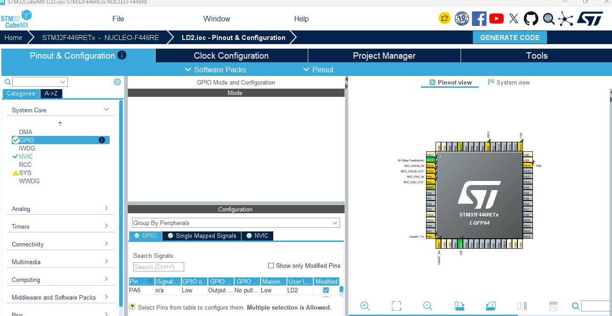
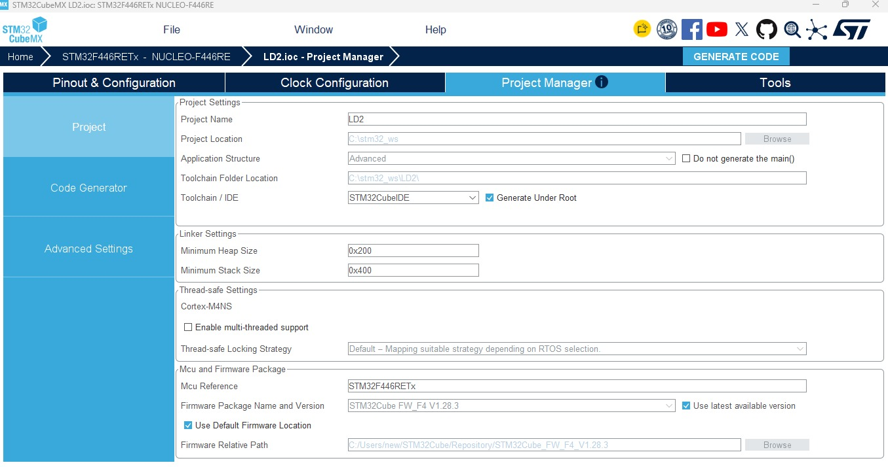
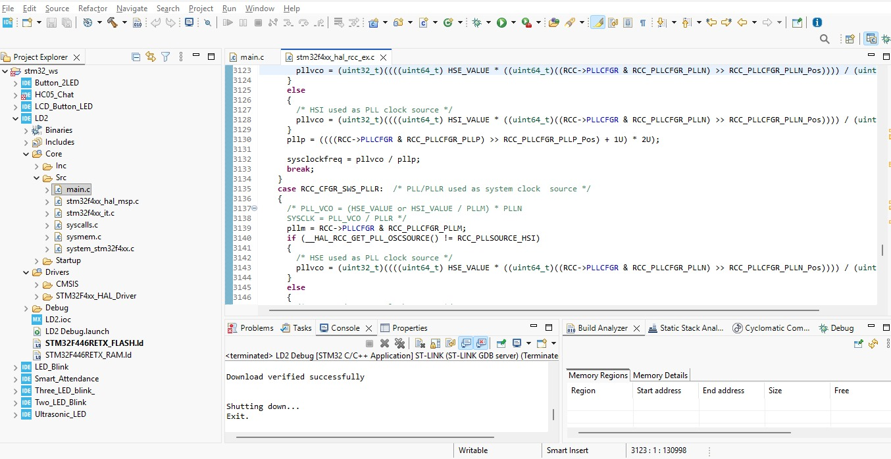

# STM32 NUCLEO-F446RE LED Blink

##  Project Overview

This project demonstrates how to blink the onboard **LD2 LED connected to PA5** on the STM32 NUCLEO-F446RE development board using the STM32 HAL library.

The LED toggles every 1 second using the `HAL_GPIO_TogglePin()` and `HAL_Delay()` functions.

##  Hardware and Software Requirements

- **Development Board:** STM32 NUCLEO-F446RE
- **Microcontroller:** STM32F446RE
- **IDE:** STM32CubeIDE
- **Configuration Tool:** STM32CubeMX
- **Programming Language:** Embedded C
- **Library:** STM32 HAL

##  GPIO Configuration

| Parameter | Configuration |
|---|---|
| LED | Onboard LD2 |
| GPIO Pin | PA5 |
| GPIO Mode | Output Push-Pull |
| Pull-up/Pull-down | No Pull-up and No Pull-down |
| Output Speed | Low |
| Toggle Interval | 1 second |

##  Pinout and Configuration

The onboard LD2 LED is connected to GPIO pin PA5. No external LED or additional wiring is required.

### LD2 Pinout and GPIO Configuration

### STM32CubeMX Project Manager Setup

### STM32CubeIDE Project Explorer

##  Program Logic

1. Initialize the HAL library using `HAL_Init()`.
2. Configure the system clock.
3. Initialize GPIO and configure PA5 as an output.
4. Toggle the LD2 LED using `HAL_GPIO_TogglePin()`.
5. Wait for 1000 milliseconds using `HAL_Delay()`.
6. Repeat continuously inside the `while(1)` loop.

##  Hardware Output Image

The following image shows the STM32 NUCLEO-F446RE board during the LED blink operation.

##  Demonstration Video

Watch the demonstration video to see the onboard LD2 LED blinking at one-second intervals.

[**▶ View LED Blink Demonstration Video**](https://drive.google.com/file/d/1Uio6HuSuMHTh0l28ERQCsCBaXUSfDx5t/view?usp=drivesdk)

##  Concepts Learned

- GPIO pin configuration
- STM32 HAL library functions
- System clock configuration
- LED control using GPIO
- Time delays using `HAL_Delay()`
- Basic embedded C programming

##  Future Improvements

- Implement LED blinking using a hardware timer.
- Control the LED using a push button.
- Blink multiple LEDs with different time intervals.

